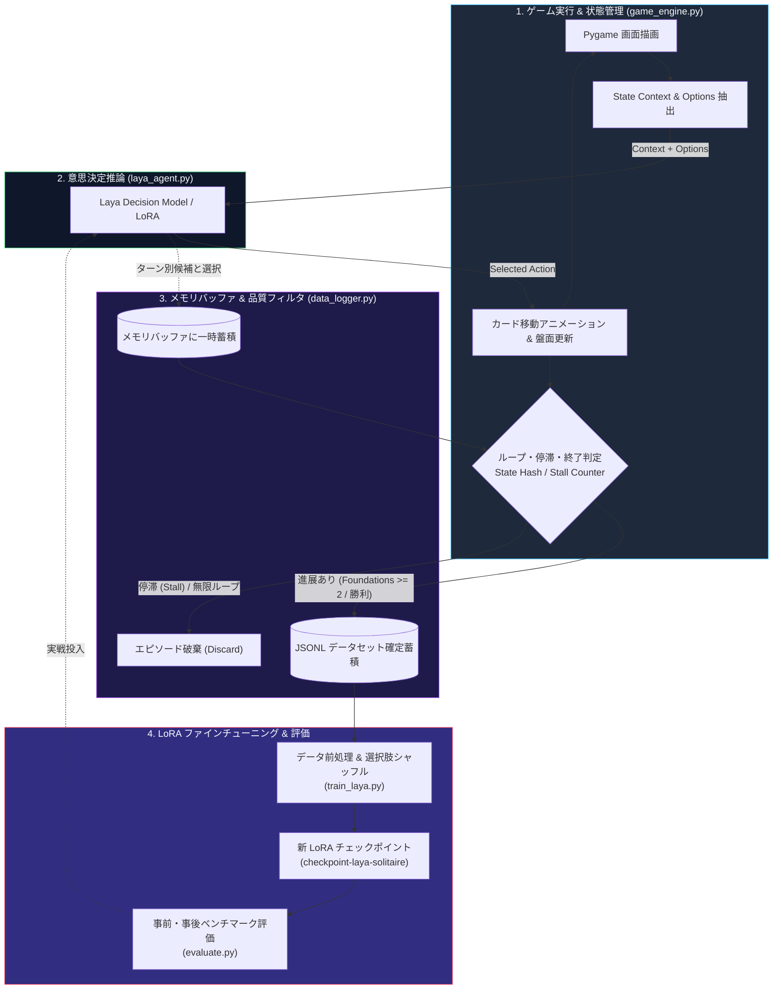

# 🃏 Laya Solitaire AI & Fine-Tuning Pipeline

[English](README.md) | [한국어](README.ko.md) | [日本語](README.ja.md)

---

Python Pygameベースのソリティア（クロンダイク）カードゲーム環境と、**Laya意思決定モデル（Decision Model）**インターフェース、リアルタイム可視化モニター、ゲームプレイログ自動収集、LoRAファインチューニング、および事前・事後性能比較ベンチマークパイプラインを統合したプロジェクトです。

---

## 📋 目次
1. [必要要件 (Prerequisites)](#-必要要件-prerequisites)
2. [環境構築・インストール (Installation)](#-環境構築インストール-installation)
3. [クイックスタート (Quick Start)](#-クイックスタート-quick-start)
4. [パイプライン完全再現ガイド (Full Pipeline)](#-パイプライン完全再現ガイド-full-pipeline)
   - [ステップ1: 高品質学習データの自動収集 (Headless)](#ステップ1-高品質学習データの自動収集-headless)
   - [ステップ2: パイプライン事前チェック (Dry Run)](#ステップ2-パイプライン事前チェック-dry-run)
   - [ステップ3: LoRAファインチューニングの実行](#ステップ3-loraファインチューニングの実行)
   - [ステップ4: 事前・事後のベンチマーク性能評価](#ステップ4-事前事後のベンチマーク性能評価)
   - [ステップ5: ファインチューニング済みモデルでGUI実行](#ステップ5-ファインチューニング済みモデルでgui実行)
5. [システムアーキテクチャ (System Architecture)](#-システムアーキテクチャ-system-architecture)
6. [プロジェクト構成 (Project Structure)](#-プロジェクト構成-project-structure)
7. [トラブルシューティング & FAQ (Troubleshooting)](#-トラブルシューティング--faq-troubleshooting)

---

## 💻 必要要件 (Prerequisites)

* **Python**: 3.10 または 3.11 を推奨
* **OS**: Windows, macOS, Linux 対応
* **ハードウェア**:
  * **CPU**: ゲームプレイGUI、ヒューリスティックルール、基本推論はCPUで動作可能
  * **GPU (推奨)**: NVIDIA GPU (CUDA対応, VRAM 6GB以上) - LoRAファインチューニングおよび高速ニューラル推論時に推奨

---

## ⚙️ 環境構築・インストール (Installation)

新しい環境（クリーン環境・別マシンなど）でクローンして実行する手順です。

### 1. リポジトリのクローン
```bash
git clone https://github.com/nomdle/laya-solitaire.git
cd laya-solitaire
```

### 2. Python仮想環境の作成と有効化
依存関係の衝突を防ぐため、仮想環境の使用を強く推奨します：

* **Windows (PowerShell):**
  ```powershell
  python -m venv venv
  .\venv\Scripts\activate
  ```
* **macOS / Linux (Bash/Zsh):**
  ```bash
  python3 -m venv venv
  source venv/bin/activate
  ```

### 3. 依存パッケージのインストール
PyTorchおよび必要なライブラリ（`pygame`, `transformers`, `peft`, `trl`, `laya`など）をインストールします：

```bash
pip install --upgrade pip
pip install -r requirements.txt
```

> **GPU（CUDA）を使用する場合:**  
> お使いのCUDAバージョンに合わせたPyTorchが必要な場合は、[PyTorch公式サイト](https://pytorch.org/get-started/locally/)の手順に従いインストールしてください：  
> `pip install torch --index-url https://download.pytorch.org/whl/cu121`

---

## 🚀 クイックスタート (Quick Start)

インストール後、すぐに各種モードをお試しいただけます。

### 1. ルールベース（ヒューリスティック）自律プレイ（GUI）
組み込みのエキスパートルールエンジンでソリティアをプレイします：
```bash
python game_engine.py
```

* **主なショートカットキー:**
  * `SPACE`: ボット自動プレイの一時停止 / 再開
  * `O`: 画面右側のLaya意思決定モニター（オーバーレイパネル）の表示 / 非表示
  * `N`: 1ターン（1手）手動進行
  * `R`: ゲームのリセット
  * `L`: リアルタイムデータログのオン / オフ
  * `ESC`: ゲーム終了
  * **マウス操作**: 左上の山札（Stock）をクリックして直接カードを引くこともできます。

### 2. バニラ（標準）Layaモデルでプレイ（GUI）
Hugging Face上の事前学習済みモデル（`convaiinnovations/laya`）を読み込んでプレイします：
```bash
python game_engine.py --model convaiinnovations/laya
```

### 3. 手動プレイモード
人間が自分でソリティアをプレイするモードです：
```bash
python game_engine.py --human
```

---

## 🔁 パイプライン完全再現ガイド (Full Pipeline)

本リポジトリには大容量チェックポイントや巨大なデータセットファイルは含まれていません。以下の5ステップを順に実行することで、**データ収集からモデル学習、評価まで100%再現**できます：

```text
[ステップ1: データ収集] ➔ [ステップ2: Dry Run] ➔ [ステップ3: LoRA学習] ➔ [ステップ4: 評価] ➔ [ステップ5: GUI実行]
```

### ステップ1: 高品質学習データの自動収集 (Headless)
UIを表示せずバックグラウンドで高速自律プレイを行い、無限ループや停滞（Stall）を自動除外して、実際に進展のあったエピソードのみを`dataset/laya_dataset.jsonl`に保存します：
```bash
# 検証済みの高品質エピソードを50件収集（数分で完了）
python game_engine.py --headless --collect 50
```

### ステップ2: パイプライン事前チェック (Dry Run)
データセットの読み込み、トークン長分布、選択肢のランダムシャッフル（位置バイアス防止）、LoRA対象モジュールのマッピングを事前検証します：
```bash
python train_laya.py --dry_run
```

### ステップ3: LoRAファインチューニングの実行
収集したデータセットをもとに、Laya意思決定モデルのLoRAアダプターを学習します：
```bash
python train_laya.py \
    --model_name convaiinnovations/laya \
    --dataset_path dataset/laya_dataset.jsonl \
    --output_dir ./checkpoint-laya-solitaire \
    --epochs 3 \
    --batch_size 2
```
* 学習完了後、アダプター重み（`adapter_model.safetensors`）とメタ情報が`./checkpoint-laya-solitaire/`に出力されます。

### ステップ4: 事前・事後のベンチマーク性能評価
学習前（ルールベース）と学習後（LoRAモデル）の勝率、クリア時間、組札（Foundation）の進展数をNゲーム比較評価します：
```bash
# 30エピソードで比較実行
python evaluate.py --episodes 30 --checkpoint ./checkpoint-laya-solitaire
```

* **出力結果の例:**
  ```text
  =================================================================
   [BENCHMARK] LAYA SOLITAIRE PERFORMANCE COMPARISON
  =================================================================
  Metric                    | Before (Heuristic) | After (Fine-Tuned)
  -----------------------------------------------------------------
  Clear Rate (勝率)         | 0.0%               | 0.0%              
  Avg Clear Time (クリア時間) | N/A                | N/A               
  Avg Clear Moves (クリア手数) | N/A                | N/A               
  Avg Foundations (平均進展数) | 3.7枚 / 52枚        | 5.2枚 / 52枚        
  =================================================================
  ```

### ステップ5: ファインチューニング済みモデルでGUI実行
学習したチェックポイントを読み込み、AIがリアルタイムに手を打つ様子を可視化画面で観察します：
```bash
python game_engine.py --model ./checkpoint-laya-solitaire
```

---

## 🏗️ システムアーキテクチャ (System Architecture)

ゲーム実行、ニューラル意思決定推論、品質フィルタリングデータロギング、LoRA学習を有機的に結ぶ循環構造を示すブロック図です：



---

## 📁 プロジェクト構成 (Project Structure)

```text
solitaire-bot/
├── .gitignore               # 大容量重みファイル（*.safetensors, *.pt）やキャッシュの除外設定
├── requirements.txt         # 依存パッケージ一覧
├── README.md                # 英語メインガイド
├── README.ko.md             # 韓国語ガイド
├── README.ja.md             # 日本語ガイド
├── task.md                  # 仕様要件書
├── game_engine.py           # Pygame 60FPS ゲーム環境、UI描画、アクション生成
├── laya_agent.py            # Layaモデルラッパー、LoRA推論、ヒューリスティックエンジン
├── data_logger.py           # 2段階品質フィルタリング機能付きデータロガー
├── train_laya.py            # 選択肢シャッフル対応 LoRAファインチューニングスクリプト
├── evaluate.py              # 事前/事後 比較ベンチマーク評価スクリプト
└── dataset/
    └── .gitkeep             # 空のデータセットディレクトリ保持用ファイル
```

---

## ❓ トラブルシューティング & FAQ (Troubleshooting)

### Q1. `RuntimeWarning: laya: this checkpoint ships invalid temperatures...` という警告が出ます
* **回答**: Layaモデル内部の温度パラメータに関する通知です。ライブラリ側が安全な既定値（`0.5`）へ自動補正して読み込むため、**動作上の問題は一切ありません。**

### Q2. Windowsのターミナルで文字化け・UnicodeEncodeErrorが発生します
* 全スクリプトにUTF-8出力ガード（`sys.stdout.reconfigure(encoding="utf-8")`）が組み込まれています。ターミナル側でエラーが発生する場合は、コードページをUTF-8へ切り替えてください：
  ```powershell
  chcp 65001
  ```

### Q3. GPUがなくてもCPUだけで動かせますか？
* はい。ゲーム環境、ヒューリスティックボット、データ収集、推論はCPUのみで快適に動作します。LoRA学習（`train_laya.py`）もGPUがない環境では自動的にCPUモードで実行されます。
