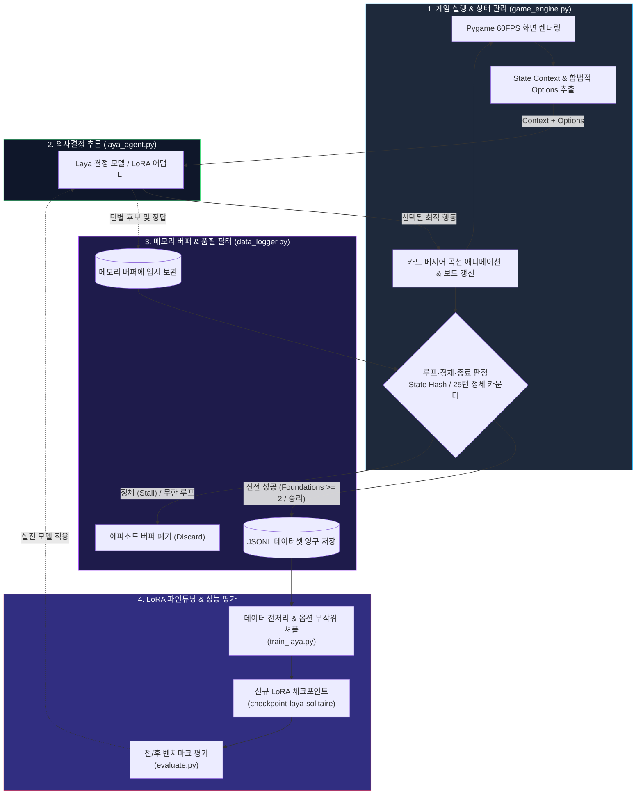

# 🃏 Laya Solitaire AI & Fine-Tuning Pipeline

[English](README.md) | [한국어](README.ko.md) | [日本語](README.ja.md)

---

Python Pygame 기반의 솔리테어(Klondike) 카드 게임 환경과 **Laya 의사결정 모델(Decision Model)** 인터페이스, 실시간 시각화 모니터, 플레이 로그 자동 수집, LoRA 파인튜닝 및 전/후 성능 평가 벤치마크 파이프라인 프로젝트입니다.

---

## 📋 목차
1. [요구 사양 (Prerequisites)](#-요구-사양-prerequisites)
2. [설치 및 환경 설정 (Installation)](#-설치-및-환경-설정-installation)
3. [빠른 실행 (Quick Start)](#-빠른-실행-quick-start)
4. [전체 파이프라인 재현 (Full Pipeline)](#-전체-파이프라인-재현-full-pipeline)
   - [1단계: 고품질 학습 데이터 자동 수집](#1단계-고품질-학습-데이터-자동-수집-headless)
   - [2단계: 파이프라인 사전 점검 (Dry Run)](#2단계-파이프라인-사전-점검-dry-run)
   - [3단계: LoRA 파인튜닝 학습](#3단계-lora-파인튜닝-학습)
   - [4단계: 사전/사후 벤치마크 성능 평가](#4단계-사전사후-벤치마크-성능-평가)
   - [5단계: 파인튜닝된 모델로 GUI 실행](#5단계-파인튜닝된-모델로-gui-실행)
5. [시스템 아키텍처 (System Architecture)](#-시스템-아키텍처-system-architecture)
6. [프로젝트 구조 (Project Structure)](#-프로젝트-구조-project-structure)
7. [문제 해결 및 FAQ (Troubleshooting)](#-문제-해결-및-faq-troubleshooting)

---

## 💻 요구 사양 (Prerequisites)

* **Python**: 3.10 또는 3.11 권장
* **OS**: Windows, macOS, Linux 지원
* **Hardware**:
  * **CPU**: 기본 게임 플레이, 휴리스틱 모드, 바닐라 Laya 모델 추론 가능
  * **GPU (권장)**: NVIDIA GPU (CUDA 지원, VRAM 6GB 이상) - LoRA 파인튜닝 및 고속 신경망 추론 시 권장

---

## ⚙️ 설치 및 환경 설정 (Installation)

다른 환경(새 PC, 서버 등)에서 처음 클론하여 세팅하는 과정입니다.

### 1. 저장소 클론 (Clone)
```bash
git clone https://github.com/nomdle/laya-solitaire.git
cd laya-solitaire
```

### 2. 파이썬 가상환경 생성 및 활성화
가상환경을 사용하여 라이브러리 충돌을 방지합니다:

* **Windows (PowerShell):**
  ```powershell
  python -m venv venv
  .\venv\Scripts\activate
  ```
* **macOS / Linux (Bash/Zsh):**
  ```bash
  python3 -m venv venv
  source venv/bin/activate
  ```

### 3. 패키지 설치
PyTorch 및 의존 라이브러리(`pygame`, `transformers`, `peft`, `trl`, `laya` 등)를 설치합니다:

```bash
pip install --upgrade pip
pip install -r requirements.txt
```

> **GPU(CUDA)를 사용하는 경우:**  
> 시스템의 CUDA 버전에 맞는 PyTorch가 필요하다면 공식 안내에 따라 PyTorch를 먼저 설치하세요:  
> `pip install torch --index-url https://download.pytorch.org/whl/cu121`

---

## 🚀 빠른 실행 (Quick Start)

설치 직후 바로 실행해 볼 수 있는 모드들입니다.

### 1. 규칙 기반(Heuristic) 봇 플레이 (GUI)
가장 기본이 되는 전문가 규칙 엔진으로 솔리테어를 자율 플레이합니다:
```bash
python game_engine.py
```

* **주요 단축키 안내:**
  * `SPACE`: 봇 자동 플레이 일시정지 / 재개
  * `O`: 우측 Laya 결정 모니터 오버레이 패널 토글 (열기/닫기)
  * `N`: 1턴(1수) 수동 진행
  * `R`: 새 게임 리셋
  * `L`: 데이터 실시간 로깅 켜기/끄기
  * `ESC`: 게임 종료
  * **마우스 조작**: 좌측 상단 스톡(Stock) 덱을 클릭해 직접 카드를 뽑을 수도 있습니다.

### 2. 순정 바닐라 Laya 모델로 실행 (GUI)
Hugging Face에서 기본 사전학습 모델(`convaiinnovations/laya`)을 다운로드하여 플레이합니다:
```bash
python game_engine.py --model convaiinnovations/laya
```

### 3. 사람이 직접 플레이 모드
```bash
python game_engine.py --human
```

---

## 🔁 전체 파이프라인 재현 (Full Pipeline)

저장소에는 대용량 체크포인트 및 데이터셋 파일이 제외되어 있으므로, 아래 5단계를 순서대로 실행하여 **데이터 수집부터 모델 학습, 평가까지 100% 재현**할 수 있습니다:

```text
[1단계: 데이터 수집] ➔ [2단계: Dry Run] ➔ [3단계: LoRA 학습] ➔ [4단계: 벤치마크 평가] ➔ [5단계: 학습 모델 GUI 실행]
```

### 1단계: 고품질 학습 데이터 자동 수집 (Headless)
UI 없이 백그라운드에서 고속으로 플레이하며, 무한 루프나 교착(Stall)을 자동으로 걸러내고 실제 진전이 있었던 판만 `dataset/laya_dataset.jsonl`에 저장합니다:
```bash
# 50개의 검증된 고품질 에피소드 수집 (수 분 소요)
python game_engine.py --headless --collect 50
```

### 2단계: 파이프라인 사전 점검 (Dry Run)
데이터셋 파싱, 옵션 무작위 셔플(위치 편향 방지), LoRA 레이어 매핑이 정상인지 사전 검증합니다:
```bash
python train_laya.py --dry_run
```

### 3단계: LoRA 파인튜닝 학습
수집된 데이터를 바탕으로 Laya 결정 모델의 LoRA 어댑터를 학습시킵니다:
```bash
python train_laya.py \
    --model_name convaiinnovations/laya \
    --dataset_path dataset/laya_dataset.jsonl \
    --output_dir ./checkpoint-laya-solitaire \
    --epochs 3 \
    --batch_size 2
```
* 학습 완료 시 `./checkpoint-laya-solitaire/` 폴더에 가중치(`adapter_model.safetensors`) 및 설정 파일이 생성됩니다.

### 4단계: 사전/사후 벤치마크 성능 평가
학습 전(규칙 기반 휴리스틱)과 학습 후(파인튜닝 모델)를 1:1로 비교 평가합니다:
```bash
# 기본 30회 에피소드 비교
python evaluate.py --episodes 30 --checkpoint ./checkpoint-laya-solitaire
```

* **출력 결과 예시:**
  ```text
  =================================================================
   [BENCHMARK] LAYA SOLITAIRE PERFORMANCE COMPARISON
  =================================================================
  Metric                    | Before (Heuristic) | After (Fine-Tuned)
  -----------------------------------------------------------------
  Clear Rate (승률)         | 0.0%               | 0.0%              
  Avg Clear Time (클리어 시간) | N/A                | N/A               
  Avg Clear Moves (클리어 턴수) | N/A                | N/A               
  Avg Foundations (평균 카드진전) | 3.7장 / 52장         | 5.2장 / 52장        
  =================================================================
  ```

### 5단계: 파인튜닝된 모델로 GUI 실행
학습된 체크포인트를 로드하여 실시간으로 수가 결정되는 모습을 관찰합니다:
```bash
python game_engine.py --model ./checkpoint-laya-solitaire
```

---

## 🏗️ 시스템 아키텍처 (System Architecture)

게임 실행, 신경망 의사결정 추론, 품질 필터링 데이터 로깅, LoRA 학습 간의 유기적인 순환 구조를 나타낸 블록 다이어그램입니다:



---

## 📁 프로젝트 구조 (Project Structure)

```text
solitaire-bot/
├── .gitignore               # 대용량 모델 가중치(*.safetensors, *.pt) 및 캐시 제외 설정
├── requirements.txt         # 설치 의존성 패키지 목록
├── README.md                # 영문 메인 가이드 문서
├── README.ko.md             # 한국어 가이드 문서
├── README.ja.md             # 일본어 가이드 문서
├── task.md                  # 프로젝트 요구사항 정의서
├── game_engine.py           # Pygame 60FPS 게임 환경, UI 렌더링, 액션 생성기
├── laya_agent.py            # Laya 모델 인터페이스, LoRA 추론 및 휴리스틱 엔진
├── data_logger.py           # 2중 품질 필터링 기반 에피소드 데이터 수집기
├── train_laya.py            # 옵션 셔플링 지원 LoRA 파인튜닝 스크립트
├── evaluate.py              # 학습 전/후 비교 측정 벤치마크 스크립트
└── dataset/
    └── .gitkeep             # 데이터셋 저장용 빈 디렉토리 보존 파일
```

---

## ❓ 문제 해결 및 FAQ (Troubleshooting)

### Q1. `RuntimeWarning: laya: this checkpoint ships invalid temperatures...` 경고가 뜹니다.
* **설명**: Laya 기본 모델의 내부 온도 파라미터에 대한 알림이며, 라이브러리가 안전값(`0.5`)으로 자동 보정하여 로드하므로 **동작에는 전혀 이상이 없습니다.**

### Q2. Windows 콘솔에서 인코딩 에러(`UnicodeEncodeError`)가 발생합니다.
* 모든 스크립트에 `sys.stdout.reconfigure(encoding="utf-8")` 안전 장치가 적용되어 있습니다. 만약 문제가 발생한다면 터미널에서 코드페이지를 변경하세요:
  ```powershell
  chcp 65001
  ```

### Q3. GPU 없이 CPU만으로도 동작하나요?
* 네. 게임 환경, 휴리스틱 봇, 데이터 수집 및 기본 추론은 CPU만으로도 충분히 실행 가능합니다. LoRA 학습(`train_laya.py`) 역시 GPU가 없으면 자동으로 CPU 모드로 폴백되어 실행됩니다.
